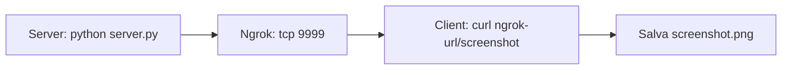

# Screenshot-pc-between-terminals

A simple client-server system for taking screenshots from a remote computer, using Python terminals and TCP sockets.
This project allows **Take a screenshot of the desktop of a remote PC** simply by launching a script on the client. The server accepts connections from the clients, a screenshot of the local desktop takes place and sends it to the client, which saves it as an image file.
It is useful in contexts of **remote monitoring**, **technical assistance**.

## How To Use
### Server side
Execute server.py on the computer from which you want to capture the screenshot:
```bash
python server.py
```
The server will listen to the 9999 door number (you can modify it in the code) and will generate a public url through [NGROK](https://ngrok.com/).

### Client side
Download the screenshot directly via Curl using the NGROK Endpoint:
```bash
curl "http://<NGROK_DOMAIN>:<NGROK_PORT>/screenshot" --output screenshot.png
```

## Workflow

